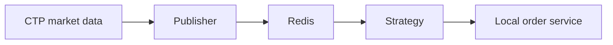

# pTrader

A 2022 Python project that separated CTP market-data ingestion from order handling. Strategies consumed market data through Redis and called a local trader client for order-service operations.

## Architecture

| Read the code | Role |
| --- | --- |
| [Market-data publisher](infra/trade/service/ctp/market_data.py) | Captures market updates and publishes them to Redis. |
| [Trader client](infra/trade/service/ctp/trader_client.py) and [order server](infra/trade/service/ctp/trader_server.py) | Provide the local client/server boundary used by strategy processes. |
| [Redis utilities](utils/buffer/) | Implement shared message transport. |

## Reproduce the 2022 test setup

Use an isolated environment with a compatible Python/CTP stack, Redis, and a test environment such as SimNow. Obtain the matching SDK and SWIG binaries from their provider and keep your credentials in a local configuration outside Git. [The Chinese README](README.md) preserves the original setup notes and credits 景色 CTP for the SWIG binding approach. The project's [MIT license](LICENSE) covers its own source. Vendor components have separate terms.

The [July 2022 commit history](https://github.com/danni2019/pTrader/commits/main/) records development of the publisher, server, and client.
